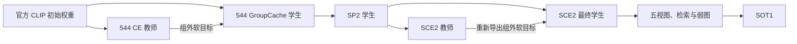

# 赛题与方法

任务是在噪声标签下做细粒度图像分类。参赛时使用 OpenAI 官方 CLIP ViT-B/32，文字塔、文本投影和 CLIP 温度冻结。可训练部分包括视觉塔、视觉投影、位置编码和分类头。分类头为 `512 → 2048 → C` 的两层 MLP，其中 `C` 是任务的类别数。训练监督来自本阶段的训练图，推理使用最终一个学生。 [赛题规则](https://www.aicomp.cn/tracks/tracks-1/3714.html) · [CLIP 论文](https://proceedings.mlr.press/v139/radford21a.html)

## 训练顺序

各训练阶段正式配置为 seed 43、80 轮、batch 256、544 像素输入。训练前用 608 短边、质量 85 制作 JPEG 缓存。训练增强包括面积比例 0.6–1.0 的随机裁剪、水平翻转、TrivialAugmentWide、图像 Mixup `α=0.2` 和标准差 `0.03` 的特征噪声。教师导出目标和推理读取原图。

| 参数 | CE 及 GroupCache | SP2 及两条 SCE2 分支 |
| --- | ---: | ---: |
| 视觉塔与投影基础学习率 | `1e-5` | `2e-6` |
| 分类头学习率 | `3e-3` | `6e-4` |
| 位置编码学习率 | `1e-6` | `2e-7` |
| 层级学习率衰减 | `0.8` | `0.8` |
| 优化器及调度 | AdamW、OneCycleLR | AdamW、OneCycleLR |

### GroupCache 的训练软目标

用官方初始 CLIP 特征做自动近重复分组。在训练集内寻找相似度超过 `0.98` 的最近邻候选，判断边时使用 FP64 复核，最后由连边的连通分量定义组。对每个训练样本，用教师特征找 60 个组外近邻。以温度 `0.02` 对余弦相似度做 softmax，再累加邻居的观测标签得到类别后验 $h_i$。

$$
r_i=0.5(1-h_i[y_i]),\qquad a_i=(1-r_i)\operatorname{onehot}(y_i)+r_i h_i.
$$

每一行原标签质量至少为 `0.5`，全部训练样本都保留。组外检索控制近重复图相互投票。生成特征的教师仍由全训练集训练，因此这个方案属于组排除邻域监督，严格组外预测需要另行交叉拟合。 [Deep k-NN for Noisy Labels](https://proceedings.mlr.press/v119/bahri20a.html)

### SP2 的训练期 OT

在线教师以学生权重初始化，随后按 EMA 更新，衰减上限 `0.999`。教师只看 Mixup 之前的训练图，温度 `0.5`。用每轮覆盖全训练集的预测记忆更新类别对偶量，列先验为训练软锚 $a_i$ 的类别均值。轮内用最近一次全局对偶给当前教师预测做校准。训练目标将锚和校准教师分布混合，混合权重 `β` 逐步升到 `0.7`。图像 Mixup 使用的行置换和系数同步应用到目标。

训练的列先验来自训练锚点。推理的 SOT1 用均匀参考分布和有限惩罚，两者的数据来源和目标各自独立。

### SCE2 的两个独立分支

从 SP2 学生分别启动 SCE2 教师和最终学生。教师用第一版组排除目标继续训练，完成后以它的新特征重新导出学生目标。学生也从 SP2 启动，建立独立的训练 EMA，并在自己的批次上重新估计梯度尺度。

令 $p$ 为学生概率，$q$ 为停止梯度且已经匹配图像 Mixup 的目标，标签平滑只作用于 CE。SCE2 用下式定义对软标签的期望反向项。 [Symmetric Cross Entropy](https://arxiv.org/abs/1908.06112)

$$
\begin{aligned}
q_{\mathrm{LS}} &= 0.85q+0.15/C,\\
L &= \operatorname{CE}(q_{\mathrm{LS}},p)+0.5\,c_{\mathrm{role}}\,r(e)(1-p\cdot q),\\
r(e) &= \min(1,\max(0,(e-8)/8)).
\end{aligned}
$$

在第 8 轮按观测标签分层累计 CE 和反向项对 logits 的梯度平方。按类等权计算两个 RMS 后，取比值为 $c_{\mathrm{role}}$。第 9–16 轮逐步启用反向项，之后固定系数。训练结束保存最终学生的原始参数。

## 单模型推理

每张原图用 `whole`、`hflip`、`zoom0.85`、`zoom0.85+hflip`、`zoom0.70` 五个视图。整图视图先按短边等比例缩放，zoom 裁剪画布中心后放回画布，最后统一成 544 方形。每个视图的投影各自归一化，求均值后再次归一化，再送分类头与检索。

推理检索库由一组固定的训练行构成，取 `k=60`、温度 `0.02` 的邻域标签后验 $p_{\mathrm{kNN}}$。在 FP32 中计算融合分数 $F$，再转 FP64。查询图间用同一模型特征构建互近邻图，`k=10`、边权温度 `0.05`，逐行归一化为 $W$，只传播一次，孤立样本保留原始分数。

$$
F=\ell_{\mathrm{head}}+0.2\log\max(p_{\mathrm{kNN}},10^{-12}),\qquad
S_0=0.9F+0.1WF.
$$

### SOT1 的半松弛传输

设 $P_i=\operatorname{softmax}(S_{0,i}/T)$、$m=\frac1N\sum_iQ_i$、$u_c=1/C$。将严格的列质量约束改成到均匀参考分布的 KL 惩罚。公式采用硬行归一化。 [Scaling Algorithms for Unbalanced Transport Problems](https://arxiv.org/abs/1607.05816)

$$
\min_{Q_i\in\Delta^{C-1}}\;\frac{1}{N}\sum_{i=1}^{N}\operatorname{KL}(Q_i\Vert P_i)
+\rho\operatorname{KL}(m\Vert u).
$$

正式件使用 `T=1`、`ρ=9`，对数域广义缩放指数为 `ρ/(1+ρ)=0.9`。迭代检查行质量和最优性条件，按 $Q$ 逐行取最大类别。`ρ=0` 对应原始行 softmax。逐步提高 `ρ` 会推近严格列均衡，但硬预测的各类别个数仍可不同。

一个容易踩的坑是列偏置。旧严格 OT 路径中的 `−1.5 log(训练先验)` 作为固定列偏置，在列质量被固定时只给目标增加常数。软列约束下该项会改变解，所以 SOT1 的输入使用未加该偏置的 $S_0$。图和 SOT 都按整批查询集构建，拆批或改变查询集构成可能改变同一张图的预测。
